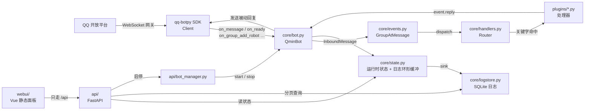

# 架构说明

Qmin 分三层：**core（框架内核）→ api（管理接口）→ webui（静态面板）**，依赖只能自上往下。
机器人链路与面板链路共用同一份运行时状态：botpy 把 QQ 事件交给 `core/bot.py`，转成语义事件后由
`core/handlers.py` 分发给插件；所有日志经 `core/state.py` 的 sink 落到 `core/logstore.py`（SQLite），
面板通过 FastAPI 读状态、读日志、启停机器人。

## 数据流



文字版（同样三条链路）：

```text
消息入站：QQ 平台 → botpy Client → core/bot.py → core/events.py → core/handlers.py → 插件
消息出站：插件 event.reply() → core/bot.py → botpy Client → QQ 平台

面板读：webui → /api/*（FastAPI）→ core/state.py（内存） / core/logstore.py（SQLite）
面板写：webui → /api/bot*（鉴权）→ api/bot_manager.py → core/bot.py（启停）

日志：任意模块 core/state.add_log() → 内存环形缓冲 + sink → core/logstore.py → SQLite
```

## 模块职责

| 模块 | 输入 | 输出 | 不做什么 |
| --- | --- | --- | --- |
| `core/bot.py` | AppID / AppSecret、运行时状态 | 网关连接；把 SDK 回调转成事件交给路由器；连接状态与入站日志 | 不处理 HTTP、不读写数据库、不做关键字匹配 |
| `core/events.py` | SDK 的 `InboundMessage`、回复闭包 | `GroupAtMessage`（只读数据类）或 `None`（非群消息） | 不拼 `msg_id` / `msg_seq`，不直接调 SDK 发送 |
| `core/handlers.py` | 装饰器注册、`GroupAtMessage` | 处理器执行结果数量；异常写 ERROR 日志 | 不解析消息、不做网络 IO、不认识插件文件 |
| `core/plugins.py` | `plugins/` 目录、安装请求（名字 + 源码） | 插件记录（启用/已加载/处理器数/错误）；安装、重载、删除 | 不做消息分发，不碰 HTTP 路由 |
| `core/state.py` | 各模块写入的状态与日志 | 连接状态、插件列表、日志环形缓冲、监听者快照 | 不持久化（交给 sink）、不做鉴权 |
| `core/logstore.py` | `LogEntry`、SDK 日志队列 | SQLite 中的可查询日志（分页/筛选/保留策略） | 不产出 HTTP 响应、不格式化给前端 |
| `core/config.py` | `.env` 文件、进程环境变量 | 校验过的 `Settings`、管理令牌生成 | 不发网络请求、不读运行时状态 |
| `core/cli.py` | 命令行参数 | `init` / `doctor` / `start` / `token` 四个命令的编排 | 不实现业务逻辑，只组装 core 与 api |
| `api/main.py` | `Settings`、插件目录、BotManager、LogStore | FastAPI 实例；lifespan 里接日志 sink、按需自动连机器人 | 不直接调用 botpy |
| `api/deps.py` | 请求头 | 令牌、Content-Type、Origin 校验结果 | 不读业务数据 |
| `api/routes/*` | HTTP 请求 | JSON 响应（状态、日志、插件、配置、启停） | 不含机器人连接逻辑（交给 `bot_manager`） |
| `webui/` | 用户操作 | 静态资源；所有数据通过 `/api/*` 获取 | 不内嵌业务规则，不直连 QQ |

## 分层规则

1. **`core/` 不得 import `api/`**，也不得依赖 FastAPI。
2. **`api/` 不得直接操作 botpy**：启停统一走 `api/bot_manager.py` → `core/bot.py`。
3. **`webui/` 只通过 `/api/*` 与后端通信**，不假设任何本地文件结构。
4. 事件模型（`core/events.py`）不依赖 botpy；SDK 类型只在 `core/bot.py` 边界处出现。

## 几个关键约定

**处理器异常隔离**：`Router.dispatch()` 逐个执行命中的处理器，单个处理器抛异常会被捕获并写一条
`ERROR`（来源 `handler`），后续处理器继续执行——插件写错不会拖垮机器人。

**凭证运行时读取**：`BotManager` 不缓存 AppID / AppSecret，每次 `start()` 都重新读 `.env`。
所以面板里改完凭证，点「启动机器人」即生效，不需要重启进程。

**日志单一入口**：所有日志都走 `RuntimeState.add_log()`，它同时写内存环形缓冲（面板实时轮询用）
和 sink（`LogStore.enqueue` → SQLite）。落库失败只会降级到内存模式，不会影响机器人。

**热重载只针对插件**：面板的安装 / 重新加载 / 启用 会按来源摘除旧处理器再重新导入，
`core/`、`api/` 的改动必须重启进程。

**管理接口默认只绑本机**：`HOST` 默认 `127.0.0.1`；写操作要求 `X-Admin-Token`、JSON Content-Type 与同源 Origin。

## 扩展点

| 想加什么 | 改哪里 |
| --- | --- |
| 新的事件装饰器（如私聊、频道） | `core/events.py` 加事件模型 → `core/handlers.py` 加装饰器与分发 → `core/bot.py` 接 SDK 回调 → 测试 + `docs/PLUGINS.md` |
| 新的管理接口 | `api/routes/` 新建路由 → `api/schema.py` 加模型 → `api/main.py` 挂载 |
| 新的 CLI 命令 | `core/cli.py` 加 `@app.command()` → 测试 → README 命令表 |
| 新的持久化数据 | `core/logstore.py` 同层新建 store，或在其中加表（保持异步、失败降级） |

具体验证要求见 [CONTRIBUTING.md](../CONTRIBUTING.md)。
